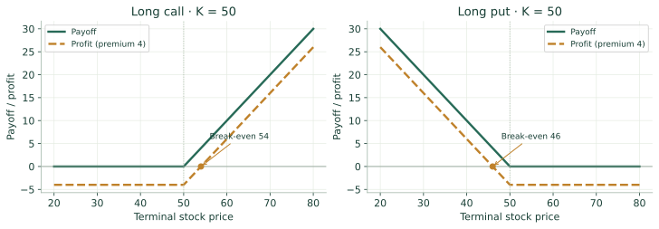
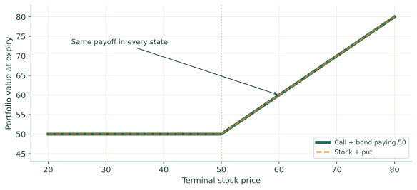
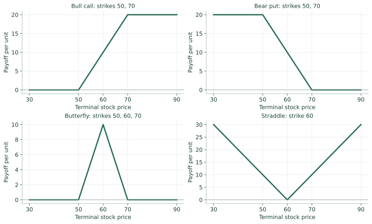
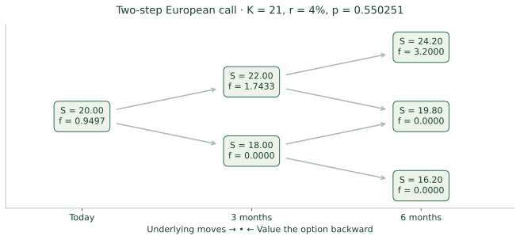
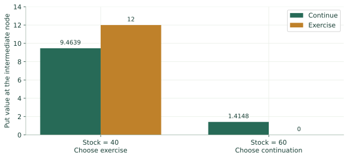
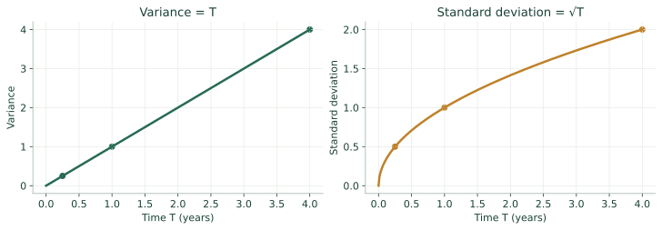
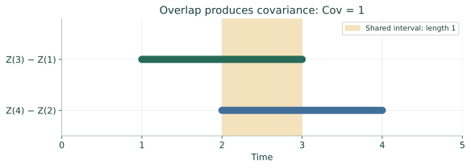
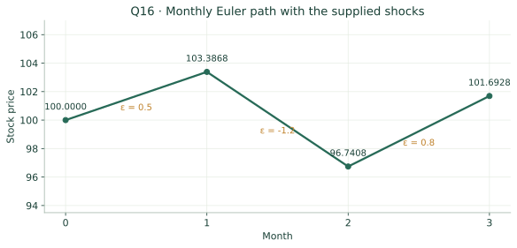

# FM9578A — Mathematics of Financial Options

Course-specific notes based on supplied Lectures 1–9. Solutions are independently worked, not official. N(m,v) uses variance. Local approximations are marked. Physical PDF page references.


## Lecture 1 · Contracts, payoffs & market language

Separate the contract, its payoff, and the investor’s profit.


### Derivatives and participants


- A derivative depends on an underlying stock, index, rate, currency, commodity or other variable. **Hedgers** reduce an existing exposure; **speculators** take a view; **arbitrageurs** exploit inconsistent prices without net risk. Exchange contracts are standardized and cleared; OTC contracts can be customized but introduce counterparty exposure. [pp. 3–10]


### Forward, futures, option


- Long forward payoff $S_T-K$; short $K-S_T$. A forward commits both parties.

- Futures are standardized and marked to market. An option buyer pays a premium for a **right**; the writer has the corresponding obligation.

- European exercise is only at expiry; American exercise is allowed earlier too. [pp. 6–12]


### Four positions: payoff ≠ profit


- Let $x^+=\max(x,0)$. Long call $(S_T-K)^+$; short call $-(S_T-K)^+$; long put $(K-S_T)^+$; short put $-(K-S_T)^+$.

- Ignoring financing, long-call profit is $(S_T-K)^+-c_0$, long-put profit $(K-S_T)^+-p_0$. Break-evens: $K+c_0$, $K-p_0$.

- If cash flows are measured at expiry with financing, subtract the future value of the premium instead. [pp. 13–17]Call $K=50$, premium $4$: at $S_T=62$, payoff $12$, profit $8$; at $48$, payoff $0$, profit $-4$. Multiply by 100 for the lecture’s 100-share contract convention.


### Moneyness and time value


- Call ITM: $S>K$; put ITM: $S<K$; ATM: $S=K$. Moneyness ignores premium, so ITM does not ensure profit.

- Intrinsic values: $(S-K)^+$ and $(K-S)^+$. Time value = option price − intrinsic value.

- American value is at least exercise value. $S=56,K=50,c=9$ gives intrinsic $6$, time value $3$. [pp. 21–22]


### Contract and quote checklist


- Check underlying, call/put, strike, expiry, style, settlement and multiplier. A **class** groups calls or puts on an underlying; a **series** fixes strike and expiry.

- Index options may be cash settled; exercising a futures option creates a futures position. Corporate actions can alter terms.

- Monthly cycles, strike intervals and LEAPS in the slides are course conventions, not universal specifications. Close a long by selling the same series; close a short by buying it back.

- Bid $4$, ask $4.50$: spread $.50$, midpoint $4.25$, 100-share immediate round trip costs $50$ before fees. [pp. 18–24]


### Lecture contract conventions


- The slides illustrate January-cycle expiries (Jan/Apr/Jul/Oct), February (Feb/May/Aug/Nov), and March (Mar/Jun/Sep/Dec). They describe third-Friday monthly expiries, additional weekly Fridays, LEAPS maturities up to 39 months and strike spacing of $2.50$, $5$ or $10$.

- These are the lecture’s examples: verify the specific contract rather than assuming every market follows them. Also check position/exercise limits and corporate-action adjustments. [pp. 19–20]


### Position direction, short profits and contract vocabulary


- **Read the market view together with the position.** A long call is bullish; a long put is bearish or protective. A short call is neutral/bearish and a short put neutral/bullish: the writer receives the premium but must meet exercise obligations. Ignoring financing, short-call profit is $c_0-(S_T-K)^+$ and short-put profit is $p_0-(K-S_T)^+$. These are the negatives of the corresponding long profits. [L1 pp. 13–16; L2 pp. 1–4]

- **OTM and exercise are different from loss and profit.** A call is OTM when $S<K$; a put is OTM when $S>K$. A long holder can sell the same series, exercise when permitted, or let the option expire. American/European names describe exercise rights, not where the option trades. [L1 pp. 11, 21–23]

- **Initial price versus collateral.** A newly agreed forward or futures contract normally has no purchase premium; the delivery price is set by the agreement. Margin may still be required. An option buyer instead pays for the right, and the option payoff has a kink while a forward payoff is linear. Credit events can also be derivative underlyings. [L1 pp. 4, 7, 12]

- **LEAPS and quotes.** LEAPS means long-term equity anticipation securities; the lecture’s maturity and expiration-cycle examples are listed in “Lecture contract conventions.” Buy at the ask and sell at the bid: at $4/4.50$, each side is $.25$ from the $4.25$ midpoint, before fees. [L1 pp. 19–20, 24]


### Reading a position from start to finish


- **Identify who has the choice.** The call buyer can buy at $K$, so exercising makes sense at expiry only when the market price is above $K$. The put buyer can sell at $K$, so the useful region is below $K$. The writer takes the opposite cash flow; the writer does not choose whether assignment occurs.

- **Separate three questions.** “Is it ITM?” compares $S_T$ with $K$. “What is the payoff?” measures the exercise benefit. “Was the trade profitable?” also includes the premium. These answers can differ: a call with $K=50,c_0=4,S_T=52$ is ITM, pays $2$, but loses $2$ before financing.

- **Build the graph by regions.** For a long call, payoff is zero through $K$ and has slope $+1$ above it. Subtracting the premium shifts the whole graph downward without changing the kink or slope. A short position reflects the long-position payoff or profit across the horizontal axis.

- **Apply the contract multiplier last.** Calculate per underlying unit first, then multiply the payoff and premium by the number of units. A quoted premium of $4$ for a 100-share option contract means $400$, not $4$, paid per contract.

- **Read the graph below.** The call’s payoff starts rising at $50$, while profit reaches zero only at $54$. The put has the opposite slope below $50$ and its profit reaches zero at $46$. These are illustrations with premium $4$ and financing ignored. [L1 pp. 13–17]


### See the idea




Dashed lines show profit after subtracting a premium of 4; solid lines show payoff. The break-even differs from the exercise threshold. Open the image for a larger view.


## Lecture 2 · Trading, valuation & margin

A quoted price, model value, premium and collateral are different things.


### Consolidated review


- Pages 1–12 repeat Lecture 1’s four positions, contract terms, moneyness, intrinsic/time value and bid–ask conventions. Those explanations are consolidated in L1 rather than silently omitted.


### Market versus model


- **Mark to market** uses observable prices; **mark to model** uses model inputs and assumptions. Market $90$ versus model $96$ need not be executable arbitrage: inspect liquidity, trading costs, model assumptions and risk. [p. 13]


### Margin mechanics


- Initial margin opens a position; maintenance margin is a minimum balance. Futures mark-to-market losses can trigger a call to restore collateral.

- Writers can have large future obligations; a fully paid option buyer’s loss is limited to the premium. Margin is collateral, not an option premium. [pp. 14–15]Authored illustration: initial $5,000$, maintenance $3,500$. Loss $1,800$ leaves $3,200$; restoring initial margin needs $1,800$.


### Missing source attachment


- Page 16 refers to Future_Margin_Example, a spreadsheet not supplied. Its numerical rows cannot be checked here.

- The illustration above is authored, not a reconstruction of that workbook.


### Follow the cash through a margin account


- **Initial margin is a deposit.** It is collateral supporting a position, not the price of the futures contract and not the maximum possible loss. Daily settlements change the balance as market prices move.

- **Calculate the daily gain or loss.** For a long futures position, a price increase produces a gain and a decrease a loss; the short position reverses the sign. Multiply the quoted price change by contract units and number of contracts before updating the balance.

- **Check the maintenance threshold after settlement.** In the authored example, $5{,}000-1{,}800=3{,}200$, which is below $3{,}500$. Restoring the initial balance requires $5{,}000-3{,}200=1{,}800$, not merely the $300$ gap to maintenance.

- **Distinguish a valuation disagreement from arbitrage.** If a model says $96$ and the market says $90$, ask whether an actual replicating portfolio locks in the difference. An uncertain model estimate alone cannot guarantee a riskless $6$ gain.

- **Source boundary.** These steps explain the mechanics from L2 pp. 13–15. The spreadsheet named on p. 16 was not supplied, so this illustration is not claimed to reproduce its numbers.


## Lecture 3 · No-arbitrage bounds & parity

Compare terminal cash flows, then compare their prices today.


### Notation and assumptions


- $S_0,S_T$ = stock now/at expiry; $K$ = strike; $T$ = years; $r$ = continuously compounded risk-free rate. $c,p$ are European call/put; $C,P$ American. Parity requires the same underlying, strike and expiry.

- Proofs assume frictionless trading, short selling and borrowing/lending at $r$. Simplified American bounds and no-early-call results assume $r\ge0$. [pp. 3–4, 9–10]


### Comparative statics


- Holding other inputs fixed: $S\uparrow$ raises calls, lowers puts; $K\uparrow$ lowers calls, raises puts; volatility raises both vanilla values in the model; $r\uparrow$ raises calls, lowers puts; dividends lower calls, raise puts. Longer maturity cannot reduce American value, but European maturity effects are not unconditional. $C\ge c$, $P\ge p$. [pp. 3–8]


### Bounds: no dividends


- $$\max(0,S_0-Ke^{-rT})\le c\le S_0,\quad \max(0,Ke^{-rT}-S_0)\le p\le Ke^{-rT}.$$ Call + bond paying $K$ dominates stock at expiry; put + stock dominates the bond. American: $C\le S_0$, $P\le K$ for $r\ge0$, and each is at least intrinsic value. [pp. 11–16]Call $S_0=51,K=50,T=.5,r=.12$: lower bound $3.9118$. Put $S_0=38,K=40,T=.25,r=.1$: lower bound $1.0124$.


### Put–call parity


- $$c+Ke^{-rT}=p+S_0.$$ Both portfolios pay $\max(S_T,K)$. If prices differ, buy the cheap portfolio and sell the expensive one; terminal obligations cancel.

- This equality is European, not arbitrary American parity. [p. 17]


### Assumptions behind an arbitrage argument


- The slides also assume trading profits are taxed consistently and arbitrage opportunities are rapidly exploited. Compare cash flows on the same dates under the same trading constraints; a difference between a model estimate and a quote alone is not a complete arbitrage proof. [L3 p. 10]


### Why maturity and upper bounds need care


- **American maturity.** A longer-lived otherwise identical American option includes the shorter contract’s exercise opportunities. The holder can choose the same exercise date, so extra time cannot reduce its value. A European holder has no such choice: a dividend between expiries can reduce a later call’s value, and a later put delays receipt of the strike. Thus the European maturity column is not always positive. [L3 pp. 5–8]

- **Call upper bound as a trade.** If a call costs more than the stock, buy the stock and write the call. The initial receipt is positive. At expiry the remaining stock-minus-call value is $\min(S_T,K)\ge0$; for an American call the held stock also meets any early delivery obligation. This proves the stock-price upper bound under the lecture’s assumptions. [L3 p. 11]

- **Put upper bounds as funded obligations.** If a European put exceeds $Ke^{-rT}$, write it and buy a bond paying $K$: the bond covers even its maximum expiry payoff. For an American put, reserve $K$ now so an earlier exercise can also be met; with $r\ge0$ the reserve does not shrink. These establish the two different upper bounds. [L3 p. 11]


### Prove a bound or parity using a cash-flow table


- **Choose portfolios with comparable expiry values.** Call plus a bond paying $K$ has payoff $(S_T-K)^++K$. Below $K$ this is $K$; above $K$ it is $S_T$. Stock plus put gives exactly the same two cases, proving European parity.

- **For a lower bound, dominance is enough.** Call plus the bond pays at least $S_T$ in both cases, so it cannot cost less than the stock. Rearranging $c+Ke^{-rT}\ge S_0$ gives the call lower bound; also impose $c\ge0$. The put bound follows from put plus stock dominating the bond.

- **Discount the strike, not the stock quote.** The bond costs $Ke^{-rT}$ today because it must pay $K$ later. Using $K$ instead would mix present and future cash flows. For Q1, $60e^{-.05(.75)}$ is about $57.7917$, giving call lower bound $6.2083$.

- **State both dates in an arbitrage answer.** Buy the cheaper portfolio and sell the expensive one. Show the positive cash receipt at time zero, then show that terminal obligations cancel or leave a nonnegative payoff. This is more convincing than saying only “the option is overpriced.”

- **Use identical contracts.** Parity requires the same underlying, strike and expiry, with the dividend adjustment appropriate to the question. Do not substitute an American option into the European equality. [L3 pp. 11–17; exercises 1–2]


### See the idea




Both European portfolios pay max(S_T, K). The equality of future cash flows explains put–call parity today. Open the image for a larger view.


## Lecture 4 · Synthetic positions & early exercise

The timing of cash flows matters.


### Synthetic positions


- $c=p+S_0-Ke^{-rT}$; $p=c+Ke^{-rT}-S_0$; $S_0=c-p+Ke^{-rT}$. Negative components mean short/sell or borrow.

- For arbitrage, compare complete portfolios at time zero and expiry. [pp. 3–5]


### Early call exercise


- For a non-dividend stock and $r\ge0$, $C=c$. Early exercise loses remaining optionality and pays $K$ sooner; holding preserves downside protection and delays payment.

- For positive rates and remaining time, the discounted-strike lower bound exceeds intrinsic value when ITM. Selling can preserve time value when exiting. [pp. 6–7]


### Early put exercise


- A deeply ITM put can benefit from receiving $K$ now. Higher rates and little benefit from waiting favor exercise.

- At each node compare exercise with discounted continuation; “ITM” alone is insufficient. [pp. 8–9]


### American bounds


- No dividends, $r\ge0$: $$S_0-K\le C-P\le S_0-Ke^{-rT}.$$ Extra exercise rights prevent a blanket fixed-expiry equality. [pp. 10–11]


### Known cash dividends


- $D$ = **present value** of known dividends. $$c\ge(S_0-D-Ke^{-rT})^+,\quad p\ge(D+Ke^{-rT}-S_0)^+,$$ $$c+D+Ke^{-rT}=p+S_0.$$ American: $S_0-D-K\le C-P\le S_0-Ke^{-rT}$. Call exercise may be optimal just before ex-dividend, but not automatically.

- Distinguish cash dividend from its present value. [pp. 12–14]


### Early exercise: volatility, intrinsic value and bound proofs


- **Put exercise incentives.** Lower stock price, higher interest rate and lower volatility generally make early put exercise more attractive. Lower volatility reduces the potential benefit of waiting, but the actual decision still compares continuation and exercise. A European put may trade below intrinsic value because it cannot collect $K-S$ immediately; its time value defined as price minus intrinsic can therefore be negative. [L4 pp. 8–9]

- **Upper American parity bound.** Without dividends and with nonnegative rates, $C=c$ and $P\ge p$. Therefore $C-P\le c-p=S_0-Ke^{-rT}$. This is an inequality because the American put may have an early-exercise premium. [L4 p. 10]

- **Lower American parity bound.** Buy a call and place $K$ in the bank; short a put and a share. If the put is exercised early, the cash covers buying the delivered share for $K$, which closes the stock short. If it survives until expiry, call-plus-cash covers put-plus-stock. Thus $C+K\ge P+S_0$, giving $C-P\ge S_0-K$. This argument uses no dividends and $r\ge0$. [L4 p. 11]


### Deciding whether to exercise early


- **Compare value now with the value of waiting.** Exercise converts an option into its immediate intrinsic cash flow or underlying transaction. Continuation retains the future choices. Being ITM tells you exercise is possible at a positive value, not that it is best.

- **For a non-dividend call, waiting has two advantages.** You postpone paying $K$ and retain protection if the stock later falls. With $r\ge0$ and no dividends to miss, early exercise adds no compensating benefit. Selling the option can recover time value if you want to exit.

- **A put can benefit from early cash.** A deeply ITM put is already close to its maximum exercise payoff. Receiving the strike earlier can outweigh the remaining optionality, especially at higher interest rates. A tree makes that trade-off explicit.

- **A cash dividend changes the call trade-off.** Exercising just before ex-dividend makes you a shareholder entitled to the dividend; continuing as an option holder does not. Compare this benefit with the interest cost of paying the strike and the option value surrendered.

- **Check the timing of dividends.** $D$ in parity is the present value of the cash payments before expiry. $D_{\rm cash}$ in a stock-price jump is the amount paid at that date. They serve different roles. [L4 pp. 6–14]


## Lecture 5 · Option strategies

Add the legs, then account for the net premium.


### Strategy workflow


- Long legs have $+$ signs, short legs $-$. Add terminal payoffs; split the $S_T$ axis at every strike; subtract net debit for profit.

- State max gain/loss and solve profit $=0$ for break-even. Use consistent cash-flow timing; ignore financing only when the question does. [pp. 2–11, 42]


### Protection and income


- Principal protection from budget $A$: bond cost $Ae^{-rT}$ pays $A$ at expiry; remaining $A(1-e^{-rT})$ buys calls when nonnegative. Protection depends on the bond assumptions.

- Covered call = stock − call, payoff $\min(S_T,K)$: capped upside, downside remains. Protective put = stock + put, payoff $\max(S_T,K)$: floor costs premium. [pp. 12–16]


### Bull and bear spreads


- $K_1<K_2$. Bull call: $+c(K_1)-c(K_2)$, payoff $\min((S_T-K_1)^+,K_2-K_1)$.

- Debit $A$: max loss $A$, max gain $K_2-K_1-A$, BE $K_1+A$. Bear put: $+p(K_2)-p(K_1)$, payoff $\min((K_2-S_T)^+,K_2-K_1)$; BE $K_2-A$. [pp. 17–23]Bull call strikes $50,70$, premiums $8,2$: debit $6$, max loss $6$, max gain $14$, BE $56$.


### Box and butterfly


- European box = bull call + bear put at identical strikes/expiry: payoff $K_2-K_1$, value $(K_2-K_1)e^{-rT}$. American early exercise complicates it.

- Equal-spacing butterfly: $+c(K_1)-2c(K_2)+c(K_3)$; peak payoff $K_2-K_1$ at $K_2$, zero outside wings; a low-movement view. [pp. 24–27]Strikes $90,100,110$, premiums $14.2,8.1,4.3$: debit $2.3$, peak profit $7.7$, BEs $92.3,107.7$. Payoff pieces: $0$, $S_T-90$, $110-S_T$, $0$. [pp. 39–41]


### Calendar and diagonal


- Calendar: short near-expiry and long later-expiry at the same strike. At the near expiry, the later leg still has time value: **do not value both legs at intrinsic value**.

- Diagonal changes both strike and expiry. [pp. 28–29]


### Movement strategies


- Straddle = call + put at $K$: payoff $|S_T-K|$, debit $A$, BEs $K\pm A$. Strangle = put $K_1$ + call $K_2>K_1$: payoff $(K_1-S_T)^++(S_T-K_2)^+$; BEs $K_1-A,K_2+A$.

- Usually cheaper but needs a bigger move. Strip = call + 2 puts (downside emphasis); strap = 2 calls + put (upside emphasis). [pp. 30–38]


### Explicit strategy formulas


- For $K_1<K_2$, the bear-put payoff is $K_2-K_1$ if $S_T\le K_1$, $K_2-S_T$ between strikes, and $0$ if $S_T\ge K_2$. The bull-call payoff is $0$, then $S_T-K_1$, then $K_2-K_1$.

- An equally spaced butterfly pays $(S_T-K_1)^+-2(S_T-K_2)^++(S_T-K_3)^+$. Strip payoff: $(S_T-K)^++2(K-S_T)^+$.

- Strap payoff: $2(S_T-K)^++(K-S_T)^+$. Subtract the total net debit for unfinanced profit. [L5 pp. 19–27, 33–34]


### Strategy families and the first-expiry decision


- **Group by ingredients.** Option-plus-stock positions include covered calls and protective puts. Spreads use options of the same type with different strikes or maturities; combinations such as straddles, strips, straps and strangles mix calls and puts. A box combines a call spread and a put spread. [L5 pp. 8–11, 17–18, 24, 30]

- **Calendar versus diagonal.** The usual long call calendar sells the nearer call and buys the later call at the same strike. It typically benefits from the price being near that strike at the first expiry, subject to the remaining option value and premiums. A diagonal changes the strike as well. Neither has a first-expiry payoff determined solely by two intrinsic values. [L5 pp. 28–29]

- **Why the box is a discounted strike difference.** Its price is $[c(K_1)-p(K_1)]-[c(K_2)-p(K_2)]$. Apply European parity at each strike: the two stock terms cancel, leaving $(K_2-K_1)e^{-rT}$. This also explains why matching expiry and European exercise matter. [L5 pp. 24–25]


### Construct a strategy rather than memorize its name


- **Write each leg with a sign.** For a bull call, buying the low-strike call contributes $(S_T-K_1)^+$ and selling the high-strike call contributes $-(S_T-K_2)^+$. This signed sum is the safest starting point.

- **Split the terminal-price axis at the strikes.** Below $K_1$, neither call pays. Between strikes, only the purchased call pays, so the slope is $+1$. Above $K_2$, both calls move dollar-for-dollar and cancel their slopes, leaving the fixed width $K_2-K_1$.

- **Account for the net premium once.** Premiums $8$ paid and $2$ received give a debit of $6$. Profit is payoff minus $6$ everywhere. With strikes $50,70$, the break-even is $56$, max gain $14$ and max loss $6$.

- **Compare shapes to choose a strategy.** A spread limits directional upside and downside. A straddle pays for a sufficiently large move either way. A long butterfly does best near the middle strike and loses its debit outside the wings. The graph below compares payoff shapes before premiums.

- **Do not combine different expiry payoffs incorrectly.** In a calendar spread, the long-dated leg remains an option at the short leg’s expiry. Its remaining time value must be valued; subtracting two intrinsic values at that date is generally wrong. [L5 pp. 17–38]


### See the idea




These are payoffs before premiums. Subtract the net debit to obtain a profit graph; do not compare payoff heights as if they were net returns. Open the image for a larger view.


## Lecture 6 · Binomial pricing I

Replication determines price; risk-neutral expectation computes it.


### Hedge one step


- For a non-dividend stock, $S_u=S_0u$, $S_d=S_0d$, payoffs $f_u,f_d$. $$\Delta=\frac{f_u-f_d}{S_u-S_d},\quad H=\Delta S_u-f_u=\Delta S_d-f_d,\quad f_0=\Delta S_0-He^{-r\Delta t}.$$ The portfolio $\Delta S-f$ is riskless. Delta is shares per option unit; multiply by contract multiplier and number of options. [pp. 3–7]


### Pricing probability


- $$p=\frac{e^{r\Delta t}-d}{u-d},\quad f_0=e^{-r\Delta t}[pf_u+(1-p)f_d].$$ Check $d<e^{r\Delta t}<u$, hence $0<p<1$. $E^Q[S_{t+\Delta t}\mid S_t]=S_te^{r\Delta t}$. $p$ is not a forecast. Physical expected return $\mu$ instead gives $p^*=(e^{\mu\Delta t}-d)/(u-d)$, if admissible. [pp. 7–10]


### One-step example


- $S_0=20,S_u=22,S_d=18,K=21,\Delta t=.25,r=.04$: payoffs $1,0$, $\Delta=.25$, $H=4.5$. Thus $f_0=5-4.5e^{-.01}=.5448$.

- Also $p=.550251$ and $f_0=e^{-.01}p$. [pp. 4–6, 9]


### Two-step tree


- Up-down = down-up for constant factors. Terminal payoff first, then work backward. $$f_0=e^{-2r\Delta t}[p^2f_{uu}+2p(1-p)f_{ud}+(1-p)^2f_{dd}].$$ The 2 counts paths to the middle price.

- Same call over two steps: prices $24.2,19.8,16.2$, payoffs $3.2,0,0$, upper value $1.7433$, lower $0$, root $.9497$. [pp. 11–14]


### Put and class exercise


- $S_0=50,K=52,u=1.2,d=.8,r=.05,\Delta t=1,N=2$: terminal $72,48,32$, put payoffs $0,4,20$, $p=.628178$, European value $4.1923$. [pp. 15–16] Class exercise $S_0=50,S_u=53,S_d=48,K=49,T=2/12,r=.10$: payoffs $4,0$, $\Delta=.8$, $p=.568063$, call $2.2347$. [pp. 17–18]


### Why replication and risk-neutral pricing agree


- **Start from terminal payoffs.** With stock $20\to22$ or $18$ and a call struck at $21$, the call pays $1$ or $0$. The difference between option payoffs is $1$, while the stock difference is $4$.

- **Choose the stock holding to cancel uncertainty.** Hold $\Delta=1/4$ shares and short one call. The up state pays $.25(22)-1=4.5$; the down state pays $.25(18)-0=4.5$. The two equal payoffs are the key check.

- **Bring the certain amount back to today.** The hedge costs $.25(20)-f_0=5-f_0$. Since it pays $4.5$ after one quarter, $5-f_0=4.5e^{-.04(.25)}$, so $f_0=.5448$. No assumption about the stock’s real-world upward probability was needed.

- **Recover the same value using the pricing probability.** Choose $p$ so the expected stock growth equals risk-free growth: $p(22)+(1-p)18=20e^{.01}$. Thus $p=.550251$ and discounted expected call payoff is $e^{-.01}[p(1)+(1-p)0]=.5448$.

- **For multiple steps, work from right to left.** The rightmost option values are known payoffs. Every earlier node is a one-step pricing problem with the two child values as its inputs. Recombination merges up-down and down-up prices; it does not remove either path’s probability. [L6 pp. 4–14]


### See the idea




Stock moves forward; option valuation moves backward. Each node shows the stock price S and call value f for the L6 example. Open the image for a larger view.


## Lecture 7 · Binomial pricing II

Exercise, volatility calibration and different underlyings.


### American exercise at every node


- At maturity set payoff. Earlier, compute $V=e^{-r\Delta t}[pf_u+(1-p)f_d]$ and $$f_{i,j}=\max(V,\text{exercise value}).$$ Include the root.

- In L6’s put example, at $S=40$, continuation $9.4636$ versus exercise $12$: exercise. At $60$, continue at $1.4147$.

- Root American $5.0894$ versus European $4.1923$. [pp. 3–7]


### Dynamic delta and source correction


- Recalculate $\Delta=(f_u-f_d)/(S_u-S_d)$ at every node. L6’s two-step call: root delta $.4358$, upper $.7273$, lower $0$.

- Put deltas are typically negative. **Correction:** L7 p. 13 labels the root $.9334$; the displayed parameters give $.9497$ by backward induction, agreeing with L6. [pp. 8–13]


### CRR factors


- $$\Delta t=T/N,\quad u=e^{\sigma\sqrt{\Delta t}},\quad d=1/u,\quad p=(a-d)/(u-d).$$ CRR matches diffusion variance locally as $\Delta t\to0$; it does not exactly match every finite-step variance equation. Exact two-point relative variance is $p(1-p)(u-d)^2$.

- Check convergence as $N$ grows; it need not be monotonic. The introductory measure-change discussion changes drift to risk-neutral drift but retains volatility, not a full Girsanov proof. [pp. 14–25]


### Growth factor by underlying


- Always discount at domestic $r$. Growth $a$: no-dividend stock $e^{r\Delta t}$; continuous-yield stock/index $e^{(r-q)\Delta t}$; FX quoted domestic per foreign unit $e^{(r-r_f)\Delta t}$; futures $1$.

- In each case $p=(a-d)/(u-d)$. Foreign interest acts like a yield.

- Non-income forward price $F_0=S_0e^{rT}$. [pp. 26, 33–41]


### Cash dividend caution


- At ex-dividend, $S_{\rm after}=S_{\rm before}-D_{\rm cash}$. Compare American exercise immediately before the drop.

- Replacing discrete cash dividends by continuous $q$ is not an exact cash-dividend tree. The calculator here supports yields, not discrete cash dividends. [pp. 27–32]


### Backward induction pseudocode


```
dt=T/N; set u,d,growth a,p,discount
check d < a < u
for j=0..N: v[j]=payoff(S0*u^j*d^(N-j))
for i=N-1 down to 0:
  for j=0..i:  # ascending: preserve old children
    c=discount*((1-p)*v[j]+p*v[j+1])
    v[j]=c
    if American: v[j]=max(c,payoff(S0*u^j*d^(i-j)))
return v[0]
```
Time $O(N^2)$; rolling memory $O(N)$; full tree memory $O(N^2)$. These cost statements are implementation deductions. [pp. 23–25]


### Lecture numerical examples


- **American put, p. 22:** S=50, K=52, r=0.05, T=2, N=2, sigma=0.3, put=True, american=True. Value $7.4284$, probability $0.5097$.**No-dividend call, p. 27:** S=50, K=50, r=0.05, T=0.5, N=2, sigma=0.3, american=True.

- Value $4.3397$, probability $0.5043$.**2% yield call, pp. 31–32:** S=50, K=50, r=0.05, T=0.5, N=2, sigma=0.3, q=0.02, american=True. Value $4.0558$, probability $0.4876$.**Index call, p. 33:** S=810, K=800, r=0.05, T=0.5, N=2, sigma=0.2, q=0.02.

- Value $53.3947$, probability $0.5126$.**FX American call, pp. 35–37:** S=0.61, K=0.6, r=0.05, T=0.25, N=3, sigma=0.12, q=0.07, american=True. Value $0.0189$, probability $0.4673$.At the upper node of the 2% yield call, continuation is about $8.42$, above exercise $8.09$, so do not exercise.

- The $4$ cash dividend immediately after $t=.25$ in pp. 28–29 is a separate model: compare exercise before the cash drop, not the continuous-yield example.

- **CRR American put (p. 22) — work backward:** All lists are low-to-high stock price. Terminal stock prices: 27.440582, 50.000000, 91.105940; payoffs: 24.559418, 2.000000, 0.000000.

- Step 1: stock 37.040911, 67.492940; discounted continuation 12.423019, 0.932698.

- Immediate exercise 14.959089, 0.000000; select the larger value: 14.959089, 0.932698.

- Step 0: stock 50.000000; discounted continuation 7.428402. Immediate exercise 2.000000; select the larger value: 7.428402.

- **No-dividend call (p. 27) — work backward:** All lists are low-to-high stock price.

- Terminal stock prices: 37.040911, 50.000000, 67.492940; payoffs: 0.000000, 0.000000, 17.492940.

- Step 1: stock 43.035399, 58.091712; discounted continuation 0.000000, 8.712822. Immediate exercise 0.000000, 8.091712; select the larger value: 0.000000, 8.712822.

- Step 0: stock 50.000000; discounted continuation 4.339652.

- Immediate exercise 0.000000; select the larger value: 4.339652.

- **2% yield call (pp. 31–32) — work backward:** All lists are low-to-high stock price. Terminal stock prices: 37.040911, 50.000000, 67.492940; payoffs: 0.000000, 0.000000, 17.492940.

- Step 1: stock 43.035399, 58.091712; discounted continuation 0.000000, 8.423088.

- Immediate exercise 0.000000, 8.091712; select the larger value: 0.000000, 8.423088.

- Step 0: stock 50.000000; discounted continuation 4.055832. Immediate exercise 0.000000; select the larger value: 4.055832.

- **Index call (p. 33) — work backward:** All lists are low-to-high stock price.

- Terminal stock prices: 663.171910, 810.000000, 989.336234; payoffs: 0.000000, 10.000000, 189.336234.

- Step 1: stock 732.918309, 895.188444; discounted continuation 5.062315, 100.661432; European value: 5.062315, 100.661432.

- Step 0: stock 810.000000; discounted continuation 53.394716; European value: 53.394716.

- **Currency call (pp. 35–37) — work backward:** All lists are low-to-high stock price. Terminal stock prices: 0.549790, 0.589231, 0.631501, 0.676804; payoffs: 0.000000, 0.000000, 0.031501, 0.076804.

- Step 2: stock 0.569169, 0.610000, 0.653760; discounted continuation 0.000000, 0.014660, 0.052453.

- Immediate exercise 0.000000, 0.010000, 0.053760; select the larger value: 0.000000, 0.014660, 0.053760.

- Step 1: stock 0.589231, 0.631501; discounted continuation 0.006822, 0.032795. Immediate exercise 0.000000, 0.031501; select the larger value: 0.006822, 0.032795.

- Step 0: stock 0.610000; discounted continuation 0.018881.

- Immediate exercise 0.010000; select the larger value: 0.018881.


### Practice coverage


- Lecture exercises 1–6 on pp. 42–47 are retained below; exercise 4 repeats 1. The supplied material introduces, but does not derive, the continuous-time option-pricing limit.

- No unprovided Black–Scholes or Itô-lemma chapter is added.


### Volatility matching: expanded identity


- Let $R=\Delta S/S$, taking values $u-1$ and $d-1$. Its exact two-point variance is $$\operatorname{Var}(R)=p(u-1)^2+(1-p)(d-1)^2-[p(u-1)+(1-p)(d-1)]^2.$$ With $a=pu+(1-p)d$, this equals $p(1-p)(u-d)^2=a(u+d)-ud-a^2$.

- The lecture uses the small-step target $\sigma^2\Delta t$. CRR approaches this target as the step shrinks; its factors do not solve that finite-step equation exactly in general. [L7 pp. 14–16]


### Physical versus risk-neutral stock dynamics


- For a non-dividend stock, the lecture writes $$\frac{dS}{S}=\mu\,dt+\sigma\,dW_t\quad\text{under the physical measure},$$ $$\frac{dS}{S}=r\,dt+\sigma\,dW_t^Q\quad\text{under }Q.$$ $W_t^Q$ is Brownian motion under the pricing measure. The drift changes, volatility does not; in the tree the probabilities change while $u,d$ stay the same.

- The same symbol $W$ without a measure label should not obscure which probability model is being used. [L7 pp. 17–19]


### Five-step calibration and financing intuition


- **The five-step example.** For $S_0=50,K=52,T=2,r=.05,\sigma=.30,N=5$, $\Delta t=.4$, $u=e^{.3\sqrt{.4}}=1.2089$, $d=.8272$, $a=e^{.02}=1.0202$, and $p=.5056$. Recompute these factors when changing $N$; reusing the one-year factors would change the model horizon. [L7 p. 24]

- **Forward financing proof.** Borrow $S_0$ to buy a non-income asset and deliver it at $T$. Repayment is $S_0e^{rT}$, so no-arbitrage delivery price is $F_0=S_0e^{rT}$. A forward delivery price is not an upfront option premium. The lecture’s equality with futures pricing uses its deterministic-rate setting. [L7 pp. 38–40]

- **Price growth versus total return.** Continuous dividends account for yield $q$, leaving capital growth $r-q$ under the pricing measure. Thus $pu+(1-p)d=e^{(r-q)\Delta t}$. For currency, foreign interest plays the yield role. For futures, the pricing-measure expected next futures quote equals the current quote, so $a=1$; the option cash flows are still discounted at $r$. [L7 pp. 26, 30, 33–41]


### American exercise: a worked node comparison


- **Compute the same continuation value as for a European option.** In the lecture put example, $S_0=50,K=52,u=1.2,d=.8,r=.05$, with two one-year steps. The pricing probability is about $.628178$. Terminal stock prices are $72,48,32$, with put payoffs $0,4,20$.

- **At the low intermediate node, compare two actual numbers.** At $S=40$, continuation is $e^{-.05}[p(4)+(1-p)20]=9.4636$. Exercise gives $52-40=12$. The American value there is $12$ because exercising is worth more than waiting.

- **At the high node, exercise is not attractive.** At $S=60$, exercise is zero but continuation is $1.4147$, so keep the option. Roll these selected child values back to obtain root value $5.0894$. Immediate root exercise gives only $2$.

- **Explain the premium for flexibility.** The European put must continue at the low node and is worth $4.1923$ at the root. The American is more valuable because it can avoid that inferior continuation decision. The extra right helps only where exercise beats continuation.

- **Refining the tree changes opportunities and approximation.** CRR recomputes $u,d,p$ using the smaller time step. Check that $0<p<1$, and compare several step counts if assessing convergence; do not assume each refinement moves the price in the same direction. [L7 pp. 3–7, 20–25]


### See the idea




At S=40, exercise 12 exceeds continuation 9.4636; at S=60, continuation 1.4147 exceeds exercise 0. Choose the larger value at each node. Open the image for a larger view.


## Lecture 8 · Wiener processes

Variance grows with time; SD grows with its square root.


### Processes and Markov property


- Time and state can each be discrete or continuous. Markov means the conditional future given the present does not need the earlier path.

- It does **not** mean successive levels are independent. [pp. 2–7]


### Standard Brownian motion


- $W_0=0$, continuous paths, independent increments over non-overlapping intervals, and $$W_t-W_s\sim N(0,t-s)\quad(s<t).$$ $N(m,v)$ uses **variance**, not SD, as its second parameter. $E[W_T]=0$, variance $T$, SD $\sqrt T$. A process started at $w_0$ instead has mean $w_0$. [pp. 8–18]


### Increment simulation


- $$\Delta W=\sqrt{\Delta t}\,\varepsilon,\quad\varepsilon\sim N(0,1).$$ Fresh independent shocks for disjoint steps. At $\Delta t=.01$, use $.1\varepsilon$, not $.01\varepsilon$.

- Over $N$ steps, variances add to $N\Delta t=T$; SDs do not add. Brownian paths are continuous but not ordinarily differentiable; $dW$ is not an ordinary derivative. [pp. 19–27]


### Constant coefficients: exact


- $$dX=a\,dt+b\,dW,\quad X_T=X_0+aT+bW_T,$$ $$X_T\sim N(X_0+aT,b^2T),\quad\Delta X\sim N(a\Delta t,b^2\Delta t).$$ Drift $a$: value/time; diffusion $b$: value/$\sqrt{\rm time}$; variance rate $b^2$; SD $|b|\sqrt T$. Exact finite-horizon results for constant coefficients. [pp. 28–31]


### Scaling example


- $X_0=50,a=20,b=30$, thousands and years. At one year: mean $70$, variance $900$, SD $30$; six months: mean $60$, variance $450$, SD $21.2132$.

- A Wiener process started at $25$ has $X_1\sim N(25,1)$ and $X_5\sim N(25,5)$. [pp. 22–23, 32–34]


### The slides’ z notation and conditional-law formula


- The slides also use $z(t)$ or $z_t$ for a stochastic process; in the standard Wiener examples, $dz$ plays the same role as $dW$. Always identify whether $z$ is a level or $\Delta z=z(t+\Delta t)-z(t)$ is an increment.

- The Markov statement is $$\Pr(X_{t+h}\in B\mid\mathcal F_t)=\Pr(X_{t+h}\in B\mid X_t),$$ where $B$ is any set of possible future values. For $N$ independent standard normal shocks and $T=N\Delta t$, $$W_T-W_0=\sum_{i=1}^N\sqrt{\Delta t}\,\varepsilon_i\sim N(0,T).$$ A sum of independent normals is normal; add their variances, not their standard deviations. [L8 pp. 6–14, 20–21]


### Brownian covariance and correlation: supplement


- The supplement calls standard Brownian motion $Z(t)$; here $W_t=Z(t)$ denotes the same process. For $s\le t$, write $W_t=W_s+(W_t-W_s)$.

- The later increment is independent of $W_s$, giving $\operatorname{Cov}(W_s,W_t)=\operatorname{Var}(W_s)=s$. Thus $$\operatorname{Cov}(W_s,W_t)=\min(s,t),\qquad \operatorname{Corr}(W_s,W_t)=\frac{\min(s,t)}{\sqrt{st}}=\sqrt{\frac{\min(s,t)}{\max(s,t)}}\quad(s,t>0).$$ For linear combinations, $$\operatorname{Cov}\left(\sum_i a_iW_{t_i},\sum_j b_jW_{s_j}\right)=\sum_{i,j}a_ib_j\min(t_i,s_j).$$ Use bilinearity to expand first.

- Joint Gaussianity then permits the zero-covariance independence test; nonlinear functions need a separate justification. [Brownian supplement pp. 1–3]


### Classifying processes and reading path resolution


- **Two separate classification axes.** Time can be discrete or continuous; state can independently be discrete or continuous, giving four possibilities. The lecture uses continuous time and continuous state to model asset prices, then uses discrete steps for numerical work. A time grid is a computational approximation, not a declaration that the underlying diffusion has jumps. [L8 pp. 2–3]

- **Infinitesimal notation.** Standard Brownian motion has drift rate $0$ and variance rate $1$: informally $E[dW]=0$, $\operatorname{Var}(dW)=dt$. The finite-step statement $\Delta W\sim N(0,\Delta t)$ is the precise simulation rule. Do not treat $dW/dt$ as an ordinary path derivative. [L8 pp. 24–27]

- **Same path at finer resolution.** The L9 p. 15 figure samples one Wiener path with $10,100,1000,10000$ steps. Finer sampling reveals more roughness, while the horizon variance stays $T$. To compare the same simulated path fairly, sum fine increments into coarse increments instead of generating unrelated shocks. [L8 p. 25; L9 p. 15]


### Understand what scales with time


- **A level and an increment answer different questions.** $W_4$ includes all movement from time 0 to 4. $W_4-W_2$ includes only movement after time 2. It is independent of $W_2$, even though $W_4$ itself is not.

- **Scale the variance first.** A standard Wiener increment over length $h$ has variance $h$, so its standard deviation is $\sqrt h$. If $h$ falls from $1$ to $1/4$, variance becomes $1/4$ and SD becomes $1/2$. Multiplying a normal shock by $h$ instead would give the wrong variance $h^2$.

- **Add disjoint increments to recover a longer interval.** Four independent quarterly increments have total variance $4(1/4)=1$. Their sum is normal because each increment is normal and the increments are independent; their SDs do not add to $2$.

- **For generalized Wiener motion, separate center and spread.** With $X_0=50,a=20,b=30$, six-month mean is $50+20(.5)=60$ while SD is $30\sqrt{.5}=21.2132$. Drift shifts the center; diffusion controls spread around it.

- **Use overlap to reason about dependence.** Increments over [1,3] and [2,4] share the random movement on [2,3], producing covariance $1$. Sharing only an endpoint contributes zero overlap length. The timeline below makes the shared randomness visible. [L8 pp. 8–21, 28–34; Brownian supplement]


### See the idea




Variance grows linearly, while SD grows as the square root of time. Separate panels avoid treating variance and SD as quantities with the same units. Open the image for a larger view.


### Which increments overlap?




The shared interval has length 1, so the two increments have covariance 1. Disjoint intervals, including ones that only touch at an endpoint, have covariance zero.


## Lecture 9 · Itô processes, stock models & correlation

Distinguish exact distributions from local approximations.


### Expectation and covariance


- Expectation is linear without independence. $$\operatorname{Var}\left(\sum_iX_i\right)=\sum_i\operatorname{Var}(X_i)+2\sum_{i<j}\operatorname{Cov}(X_i,X_j).$$ Independence implies zero covariance (when moments exist), not conversely in general. Pages 2–24 review L8; p. 6 explicitly gives the variance rule.


### Local conditional moments


- $$dX_t=a(X_t,t)dt+b(X_t,t)dW_t.$$ Freeze current coefficients for a small step: $$E_t[\Delta X]\approx a(X_t,t)\Delta t,\quad\operatorname{Var}_t(\Delta X)\approx b(X_t,t)^2\Delta t.$$ $E_t$ conditions on information $\mathcal F_t$. Unlike constant coefficients, frozen finite-step moments are approximate.

- State/time coefficients define a Markov diffusion under usual well-posedness assumptions. [pp. 25–28]


### Mean reversion


- $dX=\kappa(\theta-X)dt+\eta dW$, $\kappa>0$: positive drift below $\theta$, negative above. Noise remains, so attraction is not a guaranteed path.

- Variance rate $\eta^2$. [pp. 25–28; exercise 13]


### Geometric Brownian motion


- $$dS=\mu Sdt+\sigma SdW,\quad dS/S=\mu dt+\sigma dW.$$ Dollar drift $\mu S$, diffusion $\sigma S$, variance rate $\sigma^2S^2$. Locally proportional mean $\approx\mu\Delta t$, SD $\approx\sigma\sqrt{\Delta t}$; multiply by current $S$ for dollar changes.

- If $\sigma=0$, exact $S_t=S_0e^{\mu t}$. Do not claim local normal returns are the exact long-horizon GBM distribution. [pp. 29–32, 36]


### Euler simulation


- $$S_{i+1}=S_i(1+\mu\Delta t+\sigma\sqrt{\Delta t}\varepsilon_i).$$ Use the **updated** state and fresh shocks. Independent shocks do not imply independent prices.

- Euler can produce negative prices for sufficiently negative shocks: an approximation artifact. Smaller steps reduce discretization error but cost more work.

- General update: $X_{i+1}=X_i+a(X_i,t_i)\Delta t+b(X_i,t_i)\sqrt{\Delta t}\varepsilon_i$. [pp. 33–36]


### Correlated processes


- $\operatorname{Cov}(\Delta W_1,\Delta W_2)=\rho\Delta t$ implies local $\operatorname{Cov}_t(\Delta X_1,\Delta X_2)\approx\rho b_1b_2\Delta t$. For stocks: $\rho\sigma_1\sigma_2S_1S_2\Delta t$.

- Constant coefficients make the relation exact. Local/instantaneous increment correlation is $\rho$ for positive diffusion coefficients; this is exact over finite intervals for constant coefficients.

- State-dependent finite-horizon changes need not have correlation $\rho$. [p. 37]


### Correlated normals


- Independent $U,V\sim N(0,1)$: $$\varepsilon_1=U,\quad\varepsilon_2=\rho U+\sqrt{1-\rho^2}V.$$ Means $0$, variances $1$, covariance $\rho$. Reuse $U$ within a pair, generate a fresh independent pair each step.

- At $\rho=0$ jointly normal shocks are independent; $\rho=\pm1$ gives degenerate perfect dependence. [pp. 38–39]


### Lecture monthly stock example


- For $S=100$, $\mu=.08$, $\sigma=.20$, one month gives local proportional mean $.08/12=.006667$ and SD $.2/\sqrt{12}=.057735$. Dollar mean is $.6667$ and dollar SD $5.7735$.

- The local variance is $(.2\cdot100)^2/12=33.3333$, not the SD. [pp. 29–32]


### Reading simulation plots and preserving the model assumptions


- **State dependence is not automatically path dependence.** Coefficients $a(X_t,t),b(X_t,t)$ use the current state and time; a well-defined diffusion of this form is Markov. If coefficients depend on the earlier path, the single current value may no longer be enough. At the mean-reversion target $X_t=\theta$, drift is zero but random fluctuations remain. [L9 pp. 25–28]

- **The 50-path Euler figure.** L9 p. 35 uses $S_0=100,\mu=.05,\sigma=.25,\Delta t=.01$. Its red curve is the sample median at each time; dashed curves are the sample 2.5th and 97.5th percentiles. The shaded pointwise 95% simulation band is neither a guaranteed bound nor a statement that 95% of entire paths stay inside it. A different random sample changes these curves.

- **The correlated-stock figure.** L9 p. 39 compares $\rho=-.8,0,.8$. Negative correlation produces a downward-tilted cloud of one-step returns; positive correlation produces an upward tilt; zero correlation gives no systematic tilt for the Gaussian shocks. The displayed sample correlations are approximately $-.804,-.034,.789$, rather than exactly the targets, because the simulation is finite. Inspect returns rather than inferring correlation from one pair of price paths.

- **Update coupled states together.** When coefficients depend on both stocks, evaluate all drift and diffusion coefficients using the old pair of prices, then apply the correlated shocks to produce the new pair. Updating the first stock and using that new value in the second stock’s same-step coefficients would be a different scheme. [L9 pp. 37–39]


### From an SDE to a calculation or simulated path


- **Identify coefficients before substituting time.** For $dX=(4+.2X)dt+.15X\,dW$ at $X=80$, drift is $20$ and diffusion is $12$. The instantaneous variance rate is $12^2=144$, not $12$.

- **Convert rates to a small-step change.** Over $1/12$ year, the frozen-coefficient mean change is $20/12$ and variance is $144/12=12$. The corresponding Euler step is $X^+=80+20/12+\sqrt{12}\varepsilon$. These are local approximations because the coefficients can change as $X$ moves.

- **For GBM, distinguish dollars from proportions.** In $dS/S=\mu dt+\sigma dW$, coefficients describe proportional changes. Multiply by the current stock price to obtain dollar drift $\mu S$ and dollar diffusion $\sigma S$. The dollar variance then contains $S^2$.

- **Update the state after each shock.** Monthly Euler factors for Q16 multiply successively: $S_1=100g_1$, $S_2=S_1g_2$, $S_3=S_2g_3$, where $g_i=1+.06/12+.2\varepsilon_i/\sqrt{12}$. Reusing $100$ for every step would give separate one-step scenarios, not a three-month path.

- **Build correlated shocks before updating the two stocks.** Draw independent $U,V$, then set $\varepsilon_1=U$ and $\varepsilon_2=\rho U+\sqrt{1-\rho^2}V$. This keeps unit marginal variances while controlling covariance. Use a new pair at the next time step; otherwise you introduce unintended dependence across time. [L9 pp. 25–39]


### See the idea




Each point starts from the previous updated stock price. This is one deterministic calculation using the supplied shocks, not an expected-price forecast. Open the image for a larger view.


## Notation

| Symbol | Meaning |

|---|---|

| $S_0,S_t,S_T$ | Underlying price now, at time t, and at expiry; FX quote is domestic per foreign unit. |

| $K$ | Strike / exercise price. |

| $c,p;\ C,P$ | European call/put; American call/put prices. |

| $f_{i,j}$ | Option value at step i after j up moves. |

| $T,t,\Delta t,N$ | Expiry in years; current time; step T/N; number of tree/simulation steps. |

| $r,r_f,q$ | Continuous domestic rate, foreign rate, and dividend yield. |

| $D,D_{\rm cash}$ | Present value of dividends; actual cash amount at the payment date. |

| $u,d,a$ | Tree up/down multipliers and risk-neutral one-step growth factor. |

| $p,p^*,Q$ | Risk-neutral up probability, physical up probability, pricing measure. p also denotes a put price: use context. |

| $\Delta$ | Hedge ratio, shares per option unit. Δt is a time interval. |

| $\mu,\sigma$ | Annual proportional drift and annualized volatility. |

| $W_t,\Delta W,\varepsilon$ | Wiener level, increment and standard normal shock. |

| $a(X,t),b(X,t)$ | Itô drift and diffusion; variance rate b². This a is not tree growth. |

| $\mathcal F_t,E_t,\operatorname{Var}_t$ | Information at t; expectation/variance conditional on it. |

| $\rho,U,V$ | Correlation and independent standard normal variables. |

| $\kappa,\theta,\eta$ | Mean-reversion speed, target and diffusion coefficient. |

| $N(m,v),\Phi(z)$ | Normal with mean m and variance v; standard normal CDF. |

| $x^+,\operatorname{Cov},\operatorname{Corr}$ | max(x,0); covariance; covariance divided by both SDs. |

| $z(t),z_t,Z(t),dz$ | Alternative process/Wiener notation in the slides; Δz is a change, not the current level. |

| $W_t^Q$ | Wiener process under the risk-neutral probability measure Q. |

| $F_0$ | Forward delivery price or current futures quote, according to the contract being discussed. |

| $H,A$ | H: terminal cash value of the riskless stock–option hedge. A: strategy net debit, or budget in the principal-protection example. |

| $i,j,M$ | i: time-step index; j: up-move count; M: option units when hedging, or number of simulated paths in a cost calculation. |


## Suggested exercises — all 20 / 97 subparts


### Q1 · No-arbitrage bounds

$S_0=64,K=60,T=.75,r=.05$, no dividends. Find both bounds, test call $4.50$, construct arbitrage.


(a) Call lower $6.2083$, upper $64$.


(b) Put lower $0$, upper $57.7917$.


(c) Call quote violates the lower bound.


(d) Buy call and bond paying $60$; short stock. Initial receipt $64-4.5-60e^{-.0375}=$ $1.7083$. Terminal payoff $(S_T-60)^++60-S_T=(60-S_T)^+\ge0$. Invest the initial receipt.


**Why these steps work**


- Compare today’s stock quote with the present value of the strike; then apply nonnegativity to the lower bounds.

- To prove the call arbitrage, verify both the initial receipt and terminal payoff in the regions below and above the strike.


### Q2 · Parity arbitrage

$S_0=82,K=85,T=.5,r=.04,c=5.20$; test market put $9$.


(a) $c+Ke^{-rT}=p+S_0$.


(b) $p=5.2+85e^{-.02}-82=$ $6.5169$.


(c) Market put is overpriced relative to its replication.


(d) Buy call and bond paying $85$; short put and stock. Initial receipt $9+82-5.2-85e^{-.02}=$ $2.4831$. Terminal $(S_T-85)^++85-(85-S_T)^+-S_T=0$. Invest the receipt.


**Why these steps work**


- Solve parity algebraically for the unknown put before comparing it with the market quote.

- The short put and short stock fund the long call and bond. At expiry the whole position cancels for every terminal stock price.


### Q3 · Long straddle

Buy call $K=75$ for $6$ and put $K=75$ for $4$. Payoffs, profits at $60,75,95$, break-evens and sketch; ignore financing.


(a) Call $(S_T-75)^+$; put $(75-S_T)^+$.


(b) Combined payoff $|S_T-75|$.


(c) Profit $|S_T-75|-10$: $5,-10,10$ respectively.


(d) Break-evens $65,85$.


(e) V-shaped profit: slope $-1$ below $75$, $+1$ above; vertex $(75,-10)$, zero at $65,85$. See payoff explorer.


**Why these steps work**


- The call pays only above 75 and the put only below 75; adding them produces an absolute-value payoff.

- Both premiums are paid, so subtract 10 everywhere. The two break-evens are where the payoff rises back to 10.


### Q4 · American and European calls

Compare exercise rights, values and early exercise, with and without dividends.


(a) European: only at expiry. American: any allowed time through expiry.


(b) $C\ge c$: more rights cannot reduce value.


(c) No dividends and $r\ge0$: early exercise sacrifices optionality and pays the strike sooner; $C=c$.


(d) Dividends may justify exercise immediately before ex-dividend; compare the benefit with lost time value and early strike payment.


**Why these steps work**


- More exercise rights cannot reduce value because the American holder can always wait until expiry.

- For the non-dividend call, paying the strike early gives up financing value without receiving a dividend benefit.


### Q5 · One-step replication

$S_0=48,S_u=54,S_d=43,K=49,T=.25,r=.06$. Payoffs, hedge, price and probability.


(a) $f_u=5,f_d=0$.


(b) $\Delta=5/11=.454545$.


(c) Long $5/11$ shares, short one call: both states pay $H=54(5/11)-5=43(5/11)=215/11$.


(d) $f_0=48(5/11)-(215/11)e^{-.015}=$ $2.5637$.


(e) $p=(48e^{.015}-43)/11=$ $0.5205$; $e^{-.015}(5p)=$ $2.5637$.


**Why these steps work**


- Choose delta to make the up-minus-down change in the hedged portfolio zero.

- Check both terminal states explicitly, then discount the common hedge payoff. Risk-neutral valuation is a second route to the same price.


### Q6 · Pricing versus physical probability

$S_0=100,u=1.15,d=.9,r=.05,T=.25,\mu=.12$.


(a) $p_Q=(e^{.0125}-.9)/.25=$ $0.4503$.


(b) $p_Q115+(1-p_Q)90=100e^{.0125}=$ $101.2578$.


(c) $p^*=(e^{.03}-.9)/.25=$ $0.5218$.


(d) Physical probability matches expected return $\mu$; pricing probability matches $r$. Replication prices the option without the investor’s return forecast.


**Why these steps work**


- The two probabilities solve different expected-growth equations, one with r and one with mu.

- Only the pricing probability is used with risk-free discounting in this replication model; mixing physical expectation with risk-free discounting generally gives the wrong value.


### Q7 · Two-step European call

$S_0=60,u=1.12,d=.9,r=.04,\Delta t=.25,N=2,K=62$.


(a) $60\to(67.2,54)\to(75.264,60.48,48.6)$ (high to low).


(b) $p=(e^{.01}-.9)/.22=$ $0.5002$.


(c) Payoffs $13.264,0,0$.


(d) Upper intermediate $6.5690$, lower $0$; root $3.2533$.


(e) $e^{-.02}[p^2(13.264)+2p(1-p)0+(1-p)^2 0]=$ $3.2533$.


**Why these steps work**


- Build stock nodes by multiplying factors; the middle price can be reached by two paths.

- The two-step direct formula includes the factor 2 on p(1−p) because both middle paths count.


### Q8 · Two-step European put

$S_0=75,K=78,u=1.25,d=.8,r=.05,\Delta t=1,N=2$.


(a) $75\to(93.75,60)\to(117.1875,75,48)$.


(b) $p=(e^{.05}-.8)/.45=$ $0.5584$.


(c) Payoffs $0,3,30$.


(d) Upper intermediate $1.2602$, lower $14.1959$, root $6.6328$.


(e) Discount the risk-neutral expected payoff. This is valuation, not a real-world forecast.


**Why these steps work**


- A put is worth more at low terminal stock prices, so compute K−S separately at each terminal node.

- Price the two intermediate nodes first, then use those option values—not their stock prices—in the root expectation.


### Q9 · American put: exercise decisions

$S_0=45,K=48,r=.05,\sigma=.3,T=1,N=2$; CRR.


(a) $\Delta t=.5$.


(b) $u=e^{.3\sqrt{.5}}=$ $1.2363$, $d=1/u=$ $0.8089$.


(c) $p=(e^{.025}-d)/(u-d)=$ $0.5064$.


(d) Intermediate high-to-low: $55.6340$, $36.3986$. Terminal prices: $68.7809$, $45.0000$, $29.4413$. Put payoffs: $0.0000$, $3.0000$, $18.5587$.


(e) Upper: continuation $1.4443$ exceeds exercise $0$. Lower: continuation $10.4163$ below exercise $11.6014$: exercise.


(f) Root $6.2985$ exceeds immediate exercise $3$: continue. Early exercise at the low intermediate node.


**Why these steps work**


- CRR uses the square root of the half-year step in u and d.

- At intermediate nodes and at the root, compare exercise with continuation before selecting the American value; a positive intrinsic value alone does not establish optimal exercise.


### Q10 · FX call

$S_0=.72,K=.73,r=.05,r_f=.03,\sigma=.15,T=.5,N=2$. Domestic per foreign unit.


(a) $u=e^{.15\sqrt{.25}}=$ $1.0779$, $d=$ $0.9277$.


(b) $p=(e^{(.05-.03).25}-d)/(u-d)=$ $0.5146$.


(c) $S_{i,j}=.72u^jd^{i-j}$. Intermediate low-to-high: $0.6680$, $0.7761$; terminal: $0.6197$, $0.7200$, $0.8365$.


(d) Terminal payoffs low-to-high: $0.0000$, $0.0000$, $0.1065$.


(e) Discount at domestic r: call $0.0275$.


(f) Foreign interest acts as yield, reducing growth to $r-r_f$, not replacing domestic discounting.


**Why these steps work**


- Use domestic minus foreign interest for currency growth, but the domestic rate alone for discounting.

- The exchange-rate quote is domestic currency per foreign unit, so all payoffs are expressed in domestic currency per option unit.


### Q11 · Wiener distributions and tails

Standard $W_0=0$: distributions at 2 and over [2,5], moments at 4, tail at 1.5, independence.


(a) $W_2\sim N(0,2)$.


(b) $W_5-W_2\sim N(0,3)$.


(c) $E[W_4]=0$, variance $4$, SD $2$.


(d) $P(W_1>1.5)=1-\Phi(1.5)\approx.066807$.


(e) Independent non-overlapping increments are a defining property. Levels are not generally independent.


**Why these steps work**


- The normal variance of an increment is the length of its interval: 5−2=3.

- For the tail probability, W1 is already standard normal. A level at time 4 would need division by its SD, 2, before using the standard normal CDF.


### Q12 · Generalized Wiener process

$dX=8dt+12dW,X_0=30$ million; years.


(a) Drift $8$, variance rate $144$; diffusion $12$.


(b) $X_1\sim N(38,144)$.


(c) $E[X_{.5}]=34$ million.


(d) SD at two years $12\sqrt2=16.9706$ million.


(e) $P(X_1<25)=\Phi(-13/12)\approx.1393$.


**Why these steps work**


- Constant coefficients permit an exact normal distribution at the stated horizon, rather than a local approximation.

- Standardize 25 by subtracting the one-year mean 38 and dividing by SD 12, not variance 144.


### Q13 · Mean reversion

$dX=.6(50-X)dt+8dW$; drift at $40,50,65$; local moments at $40,\Delta t=.1$.


(a) $a=.6(50-X)$, $b=8$.


(b) Drifts $6,0,-9$.


(c) Drift pulls toward $50$, proportional to distance; noise remains.


(d) $E_t[\Delta X]\approx.6$, variance $\approx6.4$. Local, not exact finite-time mean-reversion moments.


**Why these steps work**


- The sign of theta minus X determines which direction the drift pulls.

- The local variance uses eta squared times the step; the state-dependent drift does not make these frozen finite-step moments exact.


### Q14 · Local Itô moments

$dX=(4+.2X)dt+.15XdW$, $X=80,\Delta t=1/12$.


(a) $a=4+.2X$, $b=.15X$.


(b) Drift $20$.


(c) Variance rate $12^2=144$.


(d) Mean change $\approx20/12=1.6667$; variance $\approx12$.


(e) $X_{t+1/12}\approx80+20/12+\sqrt{12}\varepsilon$.


**Why these steps work**


- Substitute X=80 before evaluating drift and diffusion.

- The Euler shock coefficient is b times square root dt; equivalently it is the square root of the local variance.


### Q15 · GBM: percentages and dollars

$S=120,\mu=.09,\sigma=.24$; one month.


(a) Drift $10.8$; diffusion $28.8$.


(b) $dS/S=.09dt+.24dW$.


(c) Proportional mean $\approx.0075=0.75\%$.


(d) Proportional SD $\approx.24/\sqrt{12}=.069282=6.9282\%$.


(e) Dollar mean $\approx.9$; SD $\approx8.3138$.


**Why these steps work**


- Start with percentage mean and SD, then multiply each by the current price to convert to dollar changes.

- Converting a dollar SD to variance requires squaring the full product sigma times S.


### Q16 · Three Euler steps

$S_0=100,\mu=.06,\sigma=.2,\Delta t=1/12$; shocks $.5,-1.2,.8$.


(a) $S_{i+1}=S_i(1+.06/12+.2\varepsilon_i/\sqrt{12})$.


(b) $S_1=$ $103.3868$.


(c) $S_2=$ $96.7408$; use the updated first price.


(d) $S_3=$ $101.6928$.


(e) Independent shocks do not imply independent recursively built price levels.


**Why these steps work**


- Calculate the first multiplier, multiply the current price, and carry that updated price into the next calculation.

- Do not round intermediate prices too early; later results use those prices as inputs.


### Q17 · Step-size comparison

$dS=.07Sdt+.25SdW,S_0=90$; quarter versus month.


(a) Quarter $S_{i+1}=S_i(1+.0175+.125\varepsilon_i)$.


(b) Month $S_{i+1}=S_i(1+.07/12+.25\varepsilon_i/\sqrt{12})$.


(c) At $90$: quarterly mean $1.575$, variance $126.5625$; monthly mean $.525$, variance $42.1875$ (local).


(d) Quarter the step: SD halves, since $\sqrt{\Delta t/4}=\sqrt{\Delta t}/2$.


(e) Smaller steps reduce coefficient-freezing/discretization error at greater computational cost.


**Why these steps work**


- Drift accumulates in proportion to dt while the random shock coefficient scales with square root dt.

- A smaller step reduces local approximation error but still contains randomness and requires more steps for a fixed horizon.


### Q18 · Correlated increments

$dX_1=3dt+5dW_1,dX_2=2dt+7dW_2,\rho=.65,\Delta t=.25$.


(a) Means $.75,.5$.


(b) Variances $6.25,12.25$.


(c) Covariance $.65(5)(7)(.25)=5.6875$.


(d) Correlation $.65$.


(e) Changing $\rho$ to $-.65$ reverses covariance/correlation signs; marginal means and variances remain.


**Why these steps work**


- The deterministic drift terms contribute to means, not covariance.

- Multiply the two diffusion coefficients, their Brownian correlation, and the interval length to obtain covariance.


### Q19 · Correlated shocks

Independent $U,V\sim N(0,1)$; $\varepsilon_1=U,\varepsilon_2=\rho U+\sqrt{1-\rho^2}V$.


(a) Both means are zero by linearity.


(b) First variance $1$; second $\rho^2+(1-\rho^2)=1$, using zero covariance of U,V.


(c) $\operatorname{Cov}(\varepsilon_1,\varepsilon_2)=\rho\operatorname{Var}(U)=\rho$.


(d) $\rho=-.4,U=.6,V=-1.1$: $\varepsilon_1=.6$, $\varepsilon_2=-.24-1.1\sqrt{.84}=$ $-1.2482$.


(e) Fresh independent U,V pair each step; use its correlated shocks in the stock updates.


**Why these steps work**


- Independence makes Cov(U,V)=0, eliminating the cross term from the variance calculation.

- The shared U component creates correlation, while the independent V component restores unit variance.


### Q20 · Two-stock simulation

$S_1=100,S_2=80,\mu_1=.08,\mu_2=.05,\sigma_1=.2,\sigma_2=.3,\rho=.5,\Delta t=1/12$.


(a) $S_1^+=S_1(1+.08/12+.2\varepsilon_1/\sqrt{12})$; $S_2^+=S_2(1+.05/12+.3\varepsilon_2/\sqrt{12})$.


(b) Local/Euler dollar means $\approx.6667,.3333$.


(c) Local/Euler dollar SDs $\approx5.7735,6.9282$.


(d) Local/Euler dollar covariance $\approx.5(.2)(.3)(100)(80)/12=20$.


(e) $U=.8,V=-.5$: $\varepsilon_1=.8$, $\varepsilon_2=.4-.5\sqrt{.75}=$ $-0.0330$. Updated prices $105.2855$, $80.1046$.


**Why these steps work**


- Construct both correlated shocks before evaluating either monthly stock update.

- Use the current prices and each stock’s own drift and volatility. The stated means, SDs and covariance are local/Euler quantities, not exact long-horizon GBM formulas.


## Brownian dependence supplement


### (a) $W_2\quad\text{and}\quad W_4-W_2$
Independent. Disjoint intervals [0,2] and [2,4]; covariance 0.


### (b) $W_2\quad\text{and}\quad W_4$
Dependent. Covariance $\min(2,4)=2$. The later level contains the earlier increment.


### (c) $W_3-W_1\quad\text{and}\quad W_5-W_3$
Independent. Disjoint increments; covariance 0. A shared endpoint adds no overlap length.


### (d) $W_3-W_1\quad\text{and}\quad W_4-W_2$
Dependent. Overlap [2,3] has length 1: covariance 1.


### (e) $W_5-W_2\quad\text{and}\quad W_2-W_1$
Independent. Disjoint increments; covariance 0.


### (f) $W_4+W_2\quad\text{and}\quad W_4-W_2$
Dependent. Covariance $\operatorname{Var}(W_4)-\operatorname{Var}(W_2)=4-2=2$.


### (g) $W_3-2W_2+W_1\quad\text{and}\quad W_3-W_1$
Independent. Let $X=W_2-W_1$, $Y=W_3-W_2$, independent $N(0,1)$. Pair $Y-X,Y+X$ has covariance $1-1=0$ and is jointly Gaussian, hence independent.


### (h) $W_2^2\quad\text{and}\quad W_4-W_2$
Independent. $W_2$ is independent of the later increment; squaring preserves independence. The square is not Gaussian: do not justify this solely with zero covariance.


### (i) $W_4-2W_2\quad\text{and}\quad W_2$
Dependent. Covariance $2-2(2)=-2$.


## Lecture 7 exercise answers


### Exercise 1 / 4

{'S': 78, 'K': 80, 'r': 0.03, 'T': 0.3333333333333333, 'N': 2, 'sigma': 0.3}

Value 4.6677; next-node value slope 0.5000; u 1.1303; d 0.8847; p 0.4898

To hedge 1000 short option units, buy 499.9990 shares initially; multiply again if contracts have a multiplier.

Step 0: stock [78.0]; option [4.667671238835645]

Continuation [4.667671238835645]; immediate exercise [0]

Step 1: stock [69.00882117558425, 88.16264205586167]; option [0.0, 9.57689066307579]

Continuation [0.0, 9.57689066307579]; immediate exercise [0, 8.162642055861667]

Step 2: stock [61.0540692313303, 78.0, 99.64937761884599]; option [0, 0, 19.64937761884599]


### Exercise 2

{'S': 50, 'K': 51, 'r': 0.05, 'T': 0.5, 'N': 2, 'u': 1.06, 'd': 0.95}

Value 1.6351; next-node value slope 0.5291; u 1.0600; d 0.9500; p 0.5689

Step 0: stock [50.0]; option [1.6350711385184167]

Continuation [1.6350711385184167]; immediate exercise [0]

Step 1: stock [47.5, 53.0]; option [0.0, 2.910269488814637]

Continuation [0.0, 2.910269488814637]; immediate exercise [0, 2.0]

Step 2: stock [45.125, 50.349999999999994, 56.18000000000001]; option [0, 0, 5.180000000000007]


### Exercise 3 European

{'S': 40, 'K': 42, 'r': 0.12, 'T': 0.5, 'N': 2, 'u': 1.1, 'd': 0.9, 'put': True}

Value 2.1185; next-node value slope -0.4936; u 1.1000; d 0.9000; p 0.6523

Step 0: stock [40.0]; option [2.1184803010867217]

Continuation [2.1184803010867217]; immediate exercise [2.0]

Step 1: stock [36.0, 44.0]; option [4.758712409037339, 0.8098810428403073]

Continuation [4.758712409037339, 0.8098810428403073]; immediate exercise [6.0, 0]

Step 2: stock [32.400000000000006, 39.6, 48.400000000000006]; option [9.599999999999994, 2.3999999999999986, 0]


### Exercise 3 American

{'S': 40, 'K': 42, 'r': 0.12, 'T': 0.5, 'N': 2, 'u': 1.1, 'd': 0.9, 'put': True, 'american': True}

Value 2.5374; next-node value slope -0.6488; u 1.1000; d 0.9000; p 0.6523

Step 0: stock [40.0]; option [2.5373533380173767]

Continuation [2.5373533380173767]; immediate exercise [2.0]

Step 1: stock [36.0, 44.0]; option [6.0, 0.8098810428403073]

Continuation [4.758712409037339, 0.8098810428403073]; immediate exercise [6.0, 0]

Step 2: stock [32.400000000000006, 39.6, 48.400000000000006]; option [9.599999999999994, 2.3999999999999986, 0]


### Exercise 6 call

{'S': 90, 'K': 93, 'r': 0.03, 'T': 0.75, 'N': 3, 'sigma': 0.28, 'q': 0.03, 'american': True}

Value 7.9381; next-node value slope 0.4895; u 1.1503; d 0.8694; p 0.4651

Step 0: stock [90.0]; option [7.938057803090932]

Continuation [7.938057803090932]; immediate exercise [0]

Step 1: stock [78.24224118589251, 103.52464189715046]; option [2.2423602413069705, 14.618168225412642]

Continuation [2.2423602413069705, 14.618168225412642]; immediate exercise [0, 10.52464189715046]

Step 2: stock [68.02053673101528, 90.0, 119.08168311036934]; option [0.0, 4.857987087690102, 26.08168311036934]

Continuation [0.0, 4.857987087690102, 25.886802203944054]; immediate exercise [0, 0, 26.08168311036934]

Step 3: stock [59.1342137833551, 78.24224118589251, 103.52464189715046, 136.97654000567707]; option [0, 0, 10.52464189715046, 43.976540005677066]


### Exercise 6 put

{'S': 90, 'K': 93, 'r': 0.03, 'T': 0.75, 'N': 3, 'sigma': 0.28, 'q': 0.03, 'american': True, 'put': True}

Value 10.8824; next-node value slope -0.5031; u 1.1503; d 0.8694; p 0.4651

Step 0: stock [90.0]; option [10.882406493207252]

Continuation [10.882406493207252]; immediate exercise [3.0]

Step 1: stock [78.24224118589251, 103.52464189715046]; option [16.879503140460802, 4.1602642800199305]

Continuation [16.879503140460802, 4.1602642800199305]; immediate exercise [14.75775881410749, 0]

Step 2: stock [68.02053673101528, 90.0, 119.08168311036934]; option [24.979463268984716, 7.835571252147521, 0.0]

Continuation [24.79281808879152, 7.835571252147521, 0.0]; immediate exercise [24.979463268984716, 3.0, 0]

Step 3: stock [59.1342137833551, 78.24224118589251, 103.52464189715046, 136.97654000567707]; option [33.8657862166449, 14.75775881410749, 0, 0]


Exercise 5: dt=1/12, r=.05, rf=.08, sigma=.12. u=exp(.12/sqrt(12)), d=1/u, a=exp(-.03/12), p=(a-d)/(u-d). Values: u=1.035248, d=0.965952, a=0.997503, p=0.455308.


## Limitations and corrections

L2 margin spreadsheet not supplied. L7 p13 root .9334 is inconsistent: parameters give .9497. CRR variance matching is local/asymptotic. Original source PDFs are not republished.